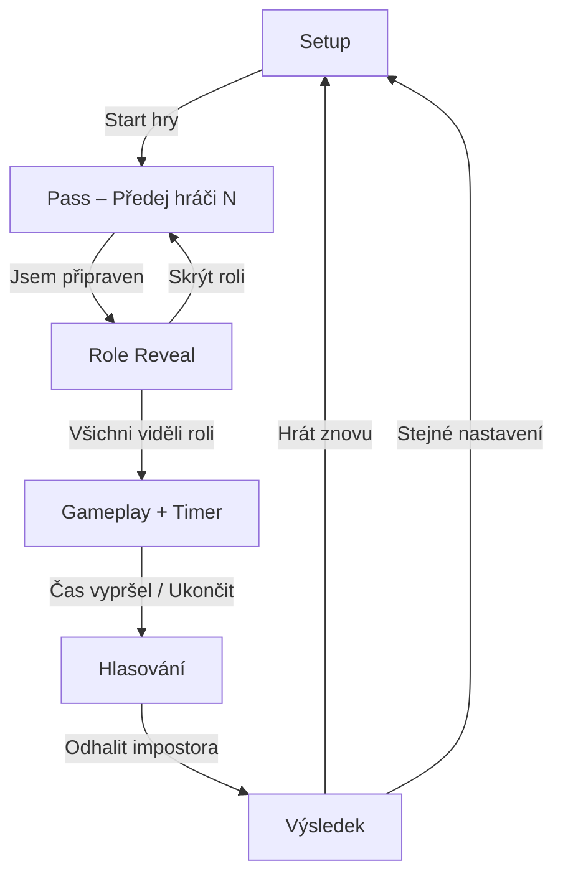

# Impostor – Pass & Play Party hra

Webová slovní party hra pro **jedno zařízení** (Pass & Play). Všichni hráči kromě Impostora znají tajné slovo – Impostor se musí tvářit, že ho zná, a zároveň ho uhodnout z nápověd ostatních.

Inspirováno hrami typu *Spyfall* a *The Chameleon*.

**Demo:** Po nasazení na GitHub Pages bude dostupné na `https://<username>.github.io/impostor-game/`

---

## Rychlý start

```bash
# Klonování (nebo stažení ZIP)
git clone https://github.com/<username>/impostor-game.git
cd impostor-game

# Lokální preview (libovolný statický server)
npx serve .
# nebo: python -m http.server 8080
```

Otevřete `http://localhost:3000` (nebo `:8080`) v prohlížeči na mobilu i desktopu.

**Není potřeba** npm install, build ani backend.

---

## Obsah dokumentace

| Dokument | Popis |
|----------|--------|
| [docs/GAME_RULES.md](docs/GAME_RULES.md) | Kompletní pravidla, tipy pro moderátora, varianty hry |
| [docs/ARCHITECTURE.md](docs/ARCHITECTURE.md) | Technická architektura, stav hry, datový model |
| [docs/DEPLOYMENT.md](docs/DEPLOYMENT.md) | GitHub Pages, vlastní doména, PWA |
| [docs/CONTRIBUTING.md](docs/CONTRIBUTING.md) | Jak přidat kategorie, slova, překlady |

---

## Struktura projektu

```
impostor-game/
├── index.html          # Hlavní HTML – obrazovky, Tailwind CDN
├── manifest.json       # PWA manifest
├── sw.js               # Service Worker (offline cache)
├── css/
│   └── styles.css      # Vlastní styly (tlačítka, karty, dialog)
├── js/
│   ├── data.js         # Slovník kategorií a slov
│   └── app.js          # Logika hry, timer, localStorage
├── assets/
│   └── icon.svg        # Ikona aplikace
└── docs/               # Podrobná dokumentace
```

---

## Herní flow (obrazovky)



### 1. Setup (hlavní menu)

- Počet hráčů: **3–10**
- Počet impostorů: **1–2** (2 až od 5 hráčů)
- Délka diskuse: **3 / 5 / 7 minut**
- Volitelně: vibrace při konci, impostor vidí kategorii (lehčí režim)

### 2. Pass & Play

Každý hráč postupně:

1. Převezme telefon
2. Klikne „Jsem připraven – ukázat roli“
3. Uvidí roli (slovo **nebo** „JSI IMPOSTOR“)
4. Po **1 sekundě** může skrýt roli a předat dál

### 3. Diskuse

- Odpočet s vizuálním progress barem
- Seznam všech kategorií a slov (pro impostora)
- Pozastavení / předčasné ukončení

### 4. Vyhodnocení

- Hlasování probíhá **ústně** (offline social game)
- Tlačítko odhalí impostory a tajné slovo

---

## Vylepšení oproti základnímu zadání

| Funkce | Popis |
|--------|--------|
| **PWA** | Instalace na plochu telefonu, částečný offline režim |
| **Obnovení hry** | Po nechtěném refreshi nabídne pokračování (localStorage) |
| **Fisher-Yates shuffle** | Spravedlivý náhodný výběr impostorů |
| **1s ochrana** | Tlačítko „Skrýt roli“ aktivní až po 1 sekundě |
| **8 kategorií** | 120+ slov (Zvířata, Města, Filmy, …) |
| **Lehký režim** | Impostor může vidět i kategorii |
| **Pozastavení času** | Pro delší diskuse nebo přestávku |
| **Přístupnost** | ARIA labely, focus stavy, reduced motion |
| **Safe areas** | Podpora výřezů displeje (notch) |

---

## Technologie

- **HTML5 / CSS3 / JavaScript (ES6+)** – vanilla, bez frameworku
- **Tailwind CSS** – přes CDN (zero build)
- **localStorage** – persistence stavu hry
- **Service Worker** – cache pro offline

Žádný backend, databáze ani API klíče.

---

## Požadavky na prohlížeč

- Moderní mobilní prohlížeč (Chrome, Safari, Firefox, Edge)
- JavaScript zapnutý
- localStorage (standardně dostupné)

---

## Licence

MIT – volně použitelné, upravitelné a hostovatelné.

---

## Autor & kontakt

Projekt vytvořen jako open-source party hra. Pull requesty s novými kategoriemi a slovy vítány – viz [docs/CONTRIBUTING.md](docs/CONTRIBUTING.md).
