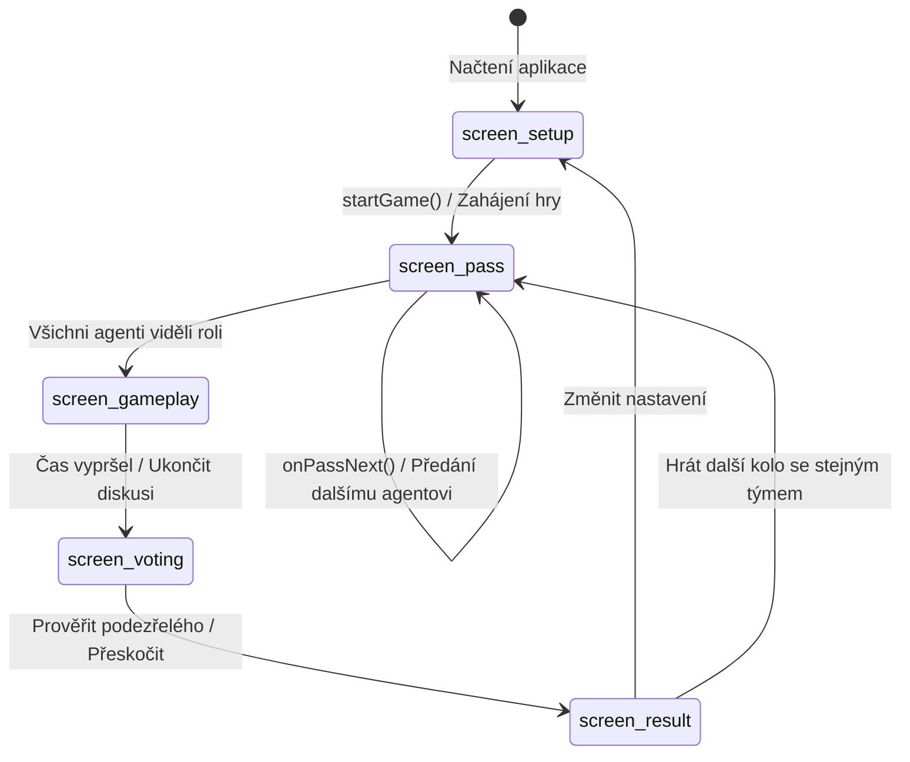

# Technická architektura: Impostor Core 🏛️

Tento dokument detailně specifikuje softwarovou architekturu, stavový model a inženýrská rozhodnutí aplikace **Impostor**.

---

## 1. Filozofie a architektonické principy

1. **Zero-Build, Zero-Runtime Dependencies:** Žádný kompilátor, bundler (Webpack/Vite) ani runtime framework (React/Vue). Kód je stoprocentně nativní standardní Vanilla JavaScript (ES6+), přímo spustitelný v moderních webových prohlížečích.
2. **Deterministic Offline-First (PWA):** Aplikace musí být plně provozuschopná v offline prostředí bez internetového připojení. Veškeré assety, logika a zvukové generátory jsou uloženy v klientské cache.
3. **Procedural Media Engine:** Žádné externí audio soubory (MP3/WAV) – veškeré zvukové vjemy jsou v reálném čase syntetizovány pomocí Web Audio API (`AudioContext`).
4. **Resilient Local Persistence:** Veškerý stav rozehrané hry, konfigurace týmu, uživatelské balíčky slov a historie skóre jsou bezpečně atomicky ukládány do `localStorage`.

---

## 2. Přehled komponent

```
┌────────────────────────────────────────────────────────┐
│                      index.html                        │
│   DOM hierarchie, sémantické sekce, dialogové modaly   │
└───────────────┬───────────────────┬────────────────────┘
                │                   │
        ┌───────▼────────┐  ┌───────▼────────┐
        │   css/styles   │  │   js/data.js   │
        │ Sémantické     │  │ 16 okruhů,     │
        │ proměnné, téma │  │ 917 slov,      │
        │ noční archiv   │  │ 83 Undercover  │
        └───────┬────────┘  └───────┬────────┘
                │                   │
        ┌───────▼───────────────────▼────────┐
        │             js/app.js              │
        │   Řídící stavový automat (FSM),    │
        │   DOM události, časovač a logika   │
        └───────────────┬────────────────────┘
                        │
        ┌───────────────┴────────────────────┐
        │                                    │
┌───────▼────────┐                  ┌────────▼───────┐
│  js/audio.js   │                  │     sw.js      │
│ Web Audio API  │                  │ PWA Service    │
│ syntezátor     │                  │ Worker (v5)    │
└────────────────┘                  └────────────────┘
```

---

## 3. Stavový automat (FSM) a přepínání obrazovek

Aplikace funguje jako stavový automat. Zobrazení jednotlivých obrazovek je řízeno třídou `hidden` a synchronizováno přes centrální funkci `showScreen(screenName)`:



### 3.1 Obrazovky (`<section class="screen">`)
- `screen-setup`: Konfigurace počtu hráčů, impostorů, výběr z 16 témat, správa jmen a režimů.
- `screen-pass`: Fyzické předávání zařízení s interaktivní voskovou pečetí a bezpečným nahlížením.
- `screen-gameplay`: Časomíra diskuse, banner prvního řečníka, náhodná Párty výzva kola a slovníková nápověda pro Impostora.
- `screen-voting`: Interaktivní Hlasovací aréna s kartami hráčů a volbou podezřelého.
- `screen-result`: Závěrečný úřední spis s odhalením rolí, tajného slova a aktualizací skóre.

---

## 4. Datový model a perzistence

### 4.1 Konfigurace hry (`setupConfig`)
```typescript
interface SetupConfig {
  playerCount: number;               // 3–12
  impostorCount: number;             // 1–2 (2 až od 5 hráčů)
  timerMinutes: number;              // 3 | 5 | 7
  vibrateOnEnd: boolean;             // Haptická odezva
  showCategoryToImpostor: boolean;   // Zda impostor vidí název tématu
  hardcoreMode: boolean;             // 3 minuty bez nápovědy
  gameMode: 'classic' | 'undercover';// Herní režim
  selectedCategories: string[];      // [] = všechna témata, nebo pole klíčů
  playerNames: string[];             // Vlastní jména agentů
  soundEnabled: boolean;             // Zvukový syntetizér
  partyChallenge: boolean;           // Modifikátory kola
}
```

### 4.2 Stav probíhajícího kola (`gameState`)
```typescript
interface GameState {
  screen: 'setup' | 'pass' | 'gameplay' | 'voting' | 'result';
  categoryKey: string;
  categoryName: string;
  word: string;                      // Hlavní slovo civilistů
  undercoverWord?: string;           // Klamné slovo pro Undercover
  impostorIndices: number[];         // 0-based indexy vetřelců
  undercoverIndices: number[];       // Indexy undercover agentů
  currentPlayerIndex: number;        // Kdo má v ruce telefon
  roleRevealed: boolean;             // Zda byla pečeť prolomena
  timerRemainingSec: number;
  timerPaused: boolean;
  firstSpeakerIndex: number;         // Vylosovaný začínající řečník
  currentChallenge: string | null;   // Aktivní výzva kola
}
```

### 4.3 Klíče v `localStorage`
- `impostor-game-state`: Kompletní snapshot rozehrané hry pro obnovení po náhodném zavření prohlížeče.
- `impostor-squad-names`: Uložená jména stálého vyšetřovacího týmu.
- `impostor-custom-words`: Uživatelský balíček vlastních slov.
- `impostor-score`: Kumulativní bilance vítězství (Tým vs. Impostoři).
- `impostor-theme`: Uživatelská volba motivu (`light` / `dark`).

---

## 5. Procedurální Web Audio syntezátor (`js/audio.js`)

Aplikace neobsahuje žádné externí zvukové soubory. Třída `ProceduralAudio` generuje akustické vlny v reálném čase:

1. **Tap / Cvaknutí klávesy (`tap`):**
   - Krátký sinusový oscilátor (120 Hz) s rychlým exponenciálním poklesem (0.04 s).
2. **Rozlomení voskové pečeti & Papír (`unseal`):**
   - Syntéza bílého šumu (`AudioBuffer`) modulovaná dolní propustí (*lowpass filter*) pro autentické zachrastění vosku, následovaná plynulým pásmovým šumem simulujícím vysunutí papíru z obálky.
3. **Dopad úředního razítka (`stamp`):**
   - Sub-basový oscilátor (80 Hz -> 30 Hz) kombinovaný s krátkým vysokofrekvenčním mechanickým cvaknutím kovového razítka.
4. **Tikot mechanických hodin (`tick`):**
   - Dva střídající se pásmové šumové impulzy na 1.8 kHz a 2.2 kHz simulující tikot analogových vyšetřovacích stopek.
5. **Akustický zvonek konce diskuse (`bell`):**
   - Dvoutónová aditivní syntéza (587 Hz a 880 Hz) s dlouhým přirozeným dozvukem (1.8 s).

---

## 6. Servisní pracovník (PWA Cache Architecture)

`sw.js` využívá hybridní strategii:
- **Network-First s Cache Fallback pro navigaci (HTML):** Zaručuje, že uživatel vždy obdrží nejnovější verzi kódu při dostupném internetovém připojení.
- **Cache-First pro statické assety:** CSS, JS moduly, manifest a vektorové ikony jsou servírovány okamžitě z lokální mezipaměti.
- **Okamžitá aktivace & čisticí mechanismus:** `self.skipWaiting()` v události `install` a `self.clients.claim()` v události `activate` okamžitě smažou staré mezipaměti a přepnou klienta na verzi `impostor-v5`.

---

## 7. Náhodnost a bezpečnost rolí

Rozdělení rolí využívá **Fisher-Yatesův shuffle algoritmus** aplikovaný na pole indexů hráčů:
- Algoritmus zaručuje uniformní pravděpodobnostní rozdělení bez zkreslení (každá permutace má pravděpodobnost přesně `1 / N!`).
- Losování začínajícího řečníka probíhá nezávislým generátorem `Math.floor(Math.random() * playerCount)`.
- V módu Undercover je náhodně určen poměr přiřazení dvojice slov (50% šance na záměnu slova A a slova B pro civilisty vs. undercover).
