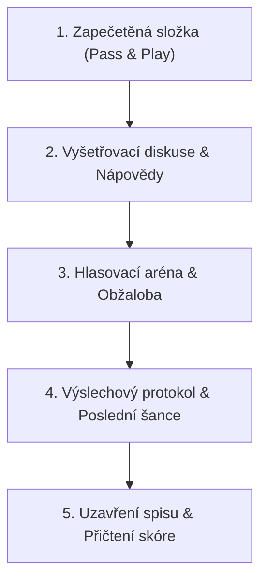

# Oficiální pravidla a příručka vyšetřovatele: Impostor 🗂️

Tento dokument slouží jako kompletní herní manuál a metodická příručka pro moderátory a hráče dedukční společenské hry **Impostor**.

---

## 1. Základní koncept a role

Hra probíhá na jednom mobilním zařízení nebo tabletu, které hráči postupně předávají v kruhu (*Pass & Play*). 

Ve hře existují tři typy rolí:

### 1.1 Civilní agenti (Innocenti)
- **Znalost:** Všichni znají shodné tajné slovo (např. `Slon`) a tematický okruh (`Zvířata`).
- **Cíl:** Dávat opatrné, chytré nápovědy potvrzující svou identitu ostatním civilistům, odhalit vetřelce u stolu a při hlasování jej poslat k výslechu.
- **Riziko:** Příliš konkrétní nápověda prozradí slovo Impostorovi, příliš vágní nápověda vzbudí podezření mezi vlastními agenty.

### 1.2 Impostor (Utajený vetřelec)
- **Znalost:** Nezná tajné slovo (v základním režimu nezná ani kategorii, pokud v nastavení není povolena).
- **Cíl:** Přežít diskusi, tvářit se přesvědčivě, poskládat nápovědy ostatních a uhodnout tajné slovo.
- **Obrana:** Pokud je při hlasování usvědčen, dostává **Poslední šanci** – pokud uhodne tajné slovo, ukradne vítězství pro sebe.

### 1.3 Undercover Agent (Mód Falešné slovo)
- **Znalost:** Zná slovo, které je téměř identické, ale odlišné od slova civilistů (např. civilisté mají `Káva`, Undercover má `Čaj`).
- **Podstata:** Undercover agent zpočátku sám netuší, že má odlišné slovo! Zjistí to teprve tehdy, když mu nápovědy ostatních začnou připadat mírně podivné.
- **Cíl:** Odhalit dříve než ostatní, že je vetřelcem, zorientovat se v civilním slově a dokonale se přizpůsobit.

---

## 2. Průběh herního kola

Každé kolo sestává ze čtyř na sebe navazujících fází:

### Fáze 1: Pass & Play (Lámání voskové pečeti)
1. Zařízení obdrží Hráč 1. Na displeji vidí zapečetěnou obálku se svým jménem nebo číslem.
2. Hráč klepne na voskovou pečeť (proběhne mechanická animace a zvuk rozlomení).
3. Z obálky se vysune tajný dopis s rolí a slovem:
   - Civilista vidí: `PŘÍSTUP POVOLEN`, kategorii a tučné tajné slovo.
   - Impostor vidí: `JSI IMPOSTOR!` a rozbalovací seznam možných kategorií.
   - Undercover vidí: své specifické klamné slovo a upozornění.
4. Hráč si slovo v klidu zapamatuje. Následně klepne na tlačítko **„Skrýt slovo & Zapečetit obálku“** (nebo přímo **„Předat dalšímu hráči“**).
5. Zařízení předá dalšímu hráči v kruhu v zapečetěném stavu.

### Fáze 2: Vyšetřovací diskuse
1. Po zhlédnutí role posledním hráčem se automaticky spustí obrazovka diskuse.
2. **První řečník:** Aplikace férově vylosuje agenta, který musí začít s první nápovědou (zamezuje rozpakům u stolu).
3. **Pravidla nápověd:**
   - Každý hráč na řadě pronese **jedno slovo** nebo **krátkou větu** (max. 5–6 slov).
   - Nápovědy pokračují po směru hodinových ručiček.
   - Doporučují se 2 kompletní kola nápověd u stolu.
4. **Párty výzva (pokud je aktivní):** Hráči musí dodržovat vylosovaný modifikátor kola (např. *pouze jednoslovné nápovědy*, *nápověda ve formě otázky*, *rýmování*).
5. **Časomíra:** Mechanický časovač odpočítává zvolený limit (3, 5 nebo 7 minut) s tikotem a zvukovým signálem.

### Fáze 3: Hlasovací aréna
1. Po vypršení času (nebo stisknutí *Ukončit diskusi & Hlasovat*) moderátor otevře Hlasovací arénu.
2. Skupina u stolu diskutuje a hlasuje.
3. V aplikaci moderátor klepne na kartu hráče, který obdržel nejvíce podezření, a potvrdí tlačítkem **„Prověřit podezřelého“**.

### Fáze 4: Výslechový protokol & Poslední šance
1. Otevře se dramatický výslechový dialog.
2. Po 2 sekundách suspense animace spadne úřední razítko a odhalí se skutečná identita podezřelého:
   - Pokud byl obviněn **Innocent**, Impostor vyvázl a tým udělal fatální chybu!
   - Pokud byl obviněn **Impostor**, aktivuje se okno **Poslední šance Impostora**.
3. **Poslední šance:** Usvědčený Impostor má právo na jeden tip tajného slova. Pokud ho moderátorovi správně řekne, klikne se na *„Uhodl tajné slovo“* a Impostor vítězí. Pokud neuhodne, vítězí Tým.

---

## 3. Kodex nápověd: Co je povoleno a co zakázáno

| Druh nápovědy | Příklad (Tajné slovo: Slon) | Přípustnost |
| :--- | :--- | :--- |
| **Metafora / Vlastnost** | „Má velmi dobrou paměť.“ | ✅ **Povoleno** (skvělá nápověda) |
| **Asociace / Kontext** | „Africká savana a cirkus.“ | ✅ **Povoleno** |
| **Přenesený význam** | „Pohyb v porcelánu.“ | ✅ **Povoleno** (chytré) |
| **Přímý překlad** | „Anglicky Elephant.“ | ❌ **Zakázáno** |
| **Slovní kořen** | „Sloní mládě.“ | ❌ **Přímo zakázáno** |
| **Hláskování / Fonetika** | „Začíná na S a má 4 písmena.“ | ❌ **Přísně zakázáno** |
| **Kódová domluva** | „To, na co jsme koukali včera ve 20:00.“ | ⚠️ **Nedoporučeno** (kazí zábavu ostatním) |

---

## 4. Doporučené sestavy a konfigurace

| Počet hráčů | Počet Impostorů | Doporučený čas | Doporučený mód |
| :---: | :---: | :---: | :--- |
| **3–4 hráči** | 1 Impostor | 3 minuty | Klasický / Rychlé tempo |
| **5–6 hráčů** | 1 Impostor | 5 minut | Undercover mód |
| **7–8 hráčů** | 2 Impostoři | 5 minut | Klasický s Párty výzvou |
| **9–12 hráčů** | 2 Impostoři | 7 minut | Týmové rozpravy a aliance |

---

## 5. Turnajový bodovací systém (Scoreboard)

Aplikace automaticky sčítá vítězství v záhlaví. Pokud hrajete celovečerní turnaj o body jednotlivců, použijte oficiální bodovací tabulku:

- **Innocent v týmu, který odhalil Impostora:** `+1 bod`
- **Impostor, který nebyl odhalen a přežil hlasování:** `+3 body`
- **Impostor, který v Poslední šanci uhodl tajné slovo:** `+2 body`
- **Undercover hráč, který přesvědčil tým a zůstal neodhalen:** `+3 body`
- **Innocent, který byl neprávem popraven týmem:** `-1 bod`
